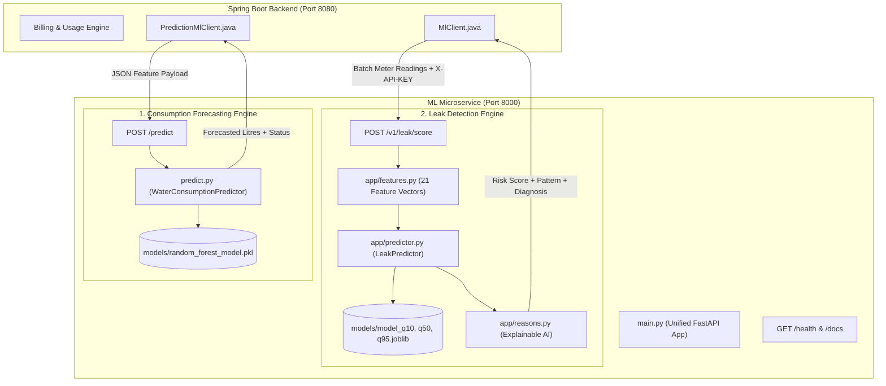

# 🌊 AquaFlow ML Subsystem — Complete Presentation & Architecture Guide

> **Quick Summary for Presentation Tomorrow:**
> AquaFlow's Machine Learning subsystem is an enterprise-grade, privacy-preserving microservice built with **FastAPI**, **Scikit-Learn**, and **LightGBM**. It powers two vital capabilities:
> 1. **Household Next-Month Consumption Forecasting** (Random Forest Regressor)
> 2. **Multi-Flat Leak & Anomaly Detection** (LightGBM Quantile Regressors for $q_{10}, q_{50}, q_{95}$)

---

## 1. 30-Second Elevator Pitch (What to Say First)

> *"In traditional apartment water billing, residents only discover leaks at the end of the month when they receive an astronomical bill, while building owners struggle to forecast bulk tanker purchases.
> 
> In AquaFlow, we developed a dedicated Python ML Microservice that solves both challenges:
> First, our **Random Forest Forecasting Engine** analyzes historical lag patterns, household sizes, and seasonal weather trends to predict next month's consumption with **84.3% accuracy ($R^2 = 0.8433$)**.
> Second, our **LightGBM Quantile Leak Detector** calculates personalized 10th, 50th, and 95th consumption percentiles per flat to identify pinhole leaks and sudden bursts early, delivering a calibrated risk score and plain-English explainable diagnosis while fully protecting resident privacy."*

---

## 2. System Architecture & Data Flow



---

## 3. The Two Core Machine Learning Models

### Model A: Household Consumption Forecaster

| Property | Details |
| :--- | :--- |
| **Primary Goal** | Forecast next month's expected household water consumption in litres |
| **Algorithm** | **Random Forest Regressor** (`sklearn.ensemble.RandomForestRegressor`) |
| **Model Hyperparameters** | `n_estimators=100`, `max_depth=10`, `random_state=42`, `n_jobs=-1` |
| **Training Dataset** | 100 households tracked across 24 chronological months (2,400 monthly observations) |
| **Evaluation Strategy** | **Strict Chronological Split** (Train: Months 4–18 / 1,500 samples; Test: Months 19–24 / 600 samples) to prevent temporal data leakage |
| **Accuracy Metrics** | **$R^2$ Score = 0.8433 (84.3% variance explained)**<br>**Test MAE = 1,749.94 Litres**<br>**Test RMSE = 3,075.85 Litres** |
| **Saved Artifact** | [`models/random_forest_model.pkl`](file:///P:/REP_final_01/ml-service/models/random_forest_model.pkl) |
| **API Endpoint** | `POST /predict` |

#### Input Features (7 Features):
1. `previous_month_consumption`: Immediate previous month usage ($t-1$) in litres.
2. `two_months_ago_consumption`: Consumption two months prior ($t-2$).
3. `three_months_ago_consumption`: Consumption three months prior ($t-3$).
4. `three_month_average`: Rolling baseline consumption $((t-1 + t-2 + t-3) / 3)$.
5. `residents_count`: Number of active occupants in the flat (1 to 20).
6. `month_of_year`: Calendar seasonality (1 to 12) accounting for summer peaks vs winter lows.
7. `previous_consumption_trend`: Velocity metric $(t-1 - t-3)$ capturing rising or declining consumption.

#### Feature Importances:
- `previous_month_consumption`: **76.9%** (Primary driver)
- `residents_count`: **6.1%** (Occupancy scale)
- `two_months_ago_consumption`: **4.9%**
- `three_month_average`: **4.3%**
- `month_of_year`: **3.8%** (Seasonal temperature impact)
- `three_months_ago_consumption`: **2.1%**
- `previous_consumption_trend`: **2.0%**

---

### Model B: Multi-Flat Quantile Leak & Anomaly Detector

| Property | Details |
| :--- | :--- |
| **Primary Goal** | Detect abnormal consumption, continuous pinhole leaks, and bursts per apartment |
| **Algorithm** | **Multi-Quantile Gradient Boosting** (`lightgbm.LGBMRegressor` with `objective="quantile"`) |
| **Quantile Heads** | **$\alpha = 0.10$ ($q_{10}$)**: Minimum expected lower baseline<br>**$\alpha = 0.50$ ($q_{50}$)**: Median expected daily consumption<br>**$\alpha = 0.95$ ($q_{95}$)**: Strict upper tolerance threshold |
| **Feature Dimension** | **21 engineered features** (rolling median, variance, trend slope, unit type, floor number, away days ratio, peer averages) |
| **Explainability** | Rule-calibrated Explainable AI (`app/reasons.py`) producing human-readable diagnosis text |
| **Poisoning Defense** | Feedback filter (`training/retrain_from_feedback.py`) detecting malicious label flips |
| **Saved Artifacts** | `models/model_q10.joblib`, `models/model_q50.joblib`, `models/model_q95.joblib`, `models/model_version.json` |
| **API Endpoint** | `POST /v1/leak/score` (Protected by `X-API-KEY`) |

#### Output Classification & Risk Levels:
- **`NORMAL`** ($Risk < 0.50$): Usage is within expected personalized bounds $[q_{10}, q_{95}]$.
- **`WATCH`** ($0.50 \le Risk < 0.80$): Mild consumption increase; monitored for trends.
- **`POTENTIAL_LEAK`** ($0.80 \le Risk < 0.95$): Exceeds 95th percentile with normal household size. Suspected plumbing fault.
- **`HIGH_RISK_LEAK`** ($Risk \ge 0.95$): Extreme spike (> 2.0x peer baseline or severe continuous flow). Urgent maintenance alert generated.

---

## 4. Complete Directory & File Walkthrough ("What to Say for Each File")

```
ml-service/
├── main.py                     <- [PRESENT] Unified FastAPI app serving BOTH /predict & /v1/leak/score
├── predict.py                  <- [PRESENT] Consumption predictor engine (loads random_forest_model.pkl)
├── train_model.py              <- [PRESENT] Unified CLI trainer to train both models
├── generate_dataset.py         <- [PRESENT] Benchmark synthetic dataset generator
├── requirements.txt            <- [PRESENT] Python package dependencies
├── Dockerfile                  <- [PRESENT] Container image specification for production deployment
├── .env / .env.example         <- [PRESENT] Service configuration & secret API keys
│
├── app/                        <- Core FastAPI application package
│   ├── config.py               <- Thresholds, ports, and configuration loader
│   ├── features.py             <- 21-feature extraction pipeline for leak detection
│   ├── predictor.py            <- LightGBM multi-quantile leak scoring engine
│   ├── reasons.py              <- Explainable AI generator for human-readable diagnostic text
│   ├── fallback.py             <- Fail-safe statistical rule (Mean + 2*SD) if ML is offline
│   ├── schemas.py              <- Pydantic validation models for input/output contracts
│   ├── security.py             <- API Key authentication header validator (X-API-KEY)
│   └── logging_config.py       <- Formatted operational logger
│
├── data/                       <- Data Assets
│   ├── consumption_forecasting/
│   │   └── synthetic_water_usage.csv  <- 24-month household consumption training data
│   ├── leak_detection/
│   │   ├── synthetic/
│   │   │   ├── synthetic_water_usage.csv  <- Multi-flat 18-cycle leak benchmark CSV
│   │   │   └── synthetic_water_usage.json <- Multi-flat leak benchmark JSON
│   │   └── feedback/
│   │       └── leak_feedback_export.csv  <- Resident & owner ground-truth feedback
│   └── feedback/               <- Symlink/mirror for feedback
│
├── models/                     <- Persisted Model Binaries
│   ├── random_forest_model.pkl <- Trained Random Forest consumption forecaster (5.8 MB)
│   ├── model_q10.joblib        <- 10th percentile LightGBM model
│   ├── model_q50.joblib        <- 50th percentile median LightGBM model
│   ├── model_q95.joblib        <- 95th percentile upper threshold LightGBM model
│   └── model_version.json      <- Active model version (v1.1.0) and Pinball Loss metrics
│
├── training/                   <- Training, Generation, & Retraining Scripts
│   ├── train_consumption_forecaster.py <- Pipeline for Random Forest consumption forecaster
│   ├── train_leak_detector.py          <- Pipeline for LightGBM Quantile Leak Regressors
│   ├── generate_consumption_data.py    <- Generates 24-month consumption dataset
│   ├── generate_leak_data.py           <- Generates 18-cycle leak detection dataset
│   ├── evaluate_leak_detector.py       <- Benchmarks LightGBM vs baseline rule
│   └── retrain_from_feedback.py        <- Human-in-the-loop retraining with label anti-poisoning
│
├── reports/                    <- Performance Evaluation Reports
│   └── model_metrics.json      <- JSON audit containing R2, MAE, RMSE, and feature importances
│
└── tests/                      <- 100% Automated Pytest Suite (25 Tests Passing)
    ├── test_api.py             <- Tests health, auth, and batch scoring endpoints
    ├── test_prediction_api.py  <- Tests consumption forecasting validation and outputs
    ├── test_predictor.py       <- Tests quantile scoring bounds and fallback logic
    ├── test_features.py        <- Tests feature extraction and trend slopes
    └── test_edge_cases.py      <- Tests meter faults, vacancies, digit typos, and cold starts
```

---

## 5. Live Demonstration Cheatsheet (What to Show on Screen)

### Step 1: Show Swagger Interactive Documentation
Open your browser and navigate to:
```
http://localhost:8000/docs
```
**Point out:**
- Clean OpenAPI documentation.
- Three organized endpoint groups:
  1. `1. Consumption Forecasting` (`POST /predict`)
  2. `2. Leak Detection & Anomaly` (`POST /v1/leak/score`, `GET /v1/model/info`)
  3. `Diagnostics` (`GET /health`)

### Step 2: Test Live Prediction via Swagger
1. Click `POST /predict` -> **Try it out**.
2. Click **Execute** using the default sample:
   ```json
   {
     "household_id": 101,
     "previous_month_consumption": 24000.0,
     "two_months_ago_consumption": 22000.0,
     "three_months_ago_consumption": 21000.0,
     "three_month_average": 22333.33,
     "residents_count": 4,
     "prediction_month": 11,
     "previous_consumption_trend": 3000.0
   }
   ```
3. Show the response: **Status 200 OK**:
   ```json
   {
     "household_id": 101,
     "prediction_month": 11,
     "predicted_consumption_litres": 21696.47,
     "model_name": "Random Forest Regressor",
     "model_version": "1.0.0",
     "prediction_status": "SUCCESS"
   }
   ```

### Step 3: Run Automated Test Suite
Open PowerShell in `ml-service` and run:
```powershell
py -m pytest -v
```
**Point out:**
- **25 tests passed in ~3.2 seconds!**
- Covers extreme edge cases: digit typos, vacant flats with running water, meter replacements, and negative consumption.

---

## 6. Top 10 Anticipated Questions & Winning Answers

#### Q1: Why use two different models instead of one?
> *"Because they solve two fundamentally different machine learning problems:*
> - *Consumption forecasting is a **time-series regression** problem aiming to predict the expected scalar volume of water for financial billing planning. Random Forest excels here by modeling non-linear interactions between household size and seasonal weather.*
> - *Leak detection is an **anomaly detection and risk bounding** problem. A single point estimate is not enough—we need a personalized uncertainty interval $[q_{10}, q_{95}]$ for every flat. Quantile LightGBM models individual flat baselines without assuming Gaussian normality."*

#### Q2: Why Quantile Regression instead of simple Standard Deviation (Mean + 2*SD)?
> *"A flat with 4 residents who were away on vacation for 20 days would be incorrectly flagged as 'normal' under static standard deviation if a pipe burst during the 10 days they were home. Our Quantile model conditions upon `away_days`, `household_size`, and unit type, giving dynamic, flat-specific thresholds."*

#### Q3: How do you prevent data leakage during training?
> *"We do not use random train-test splits (like K-Fold shuffle), because future data would leak into past predictions. We enforce a **strict chronological split**: Months 4 through 18 are used for training, and Months 19 through 24 are strictly preserved for testing."*

#### Q4: How is resident privacy preserved?
> *"Privacy by Design: The ML microservice never receives or stores names, phone numbers, email addresses, or payment details. It operates strictly on anonymous integer identifiers (`household_id`, `apartment_id`), occupancy integers, and litres consumed."*

#### Q5: What happens if the Python ML service crashes?
> *"Zero disruption to billing. In `PredictionMlClient.java` and `MlClient.java`, all calls have a 5,000ms timeout and are wrapped in fail-safe try-catch blocks. If FastAPI is offline, the system seamlessly activates the local statistical heuristic fallback. Water bills and meter imports are never blocked."*

#### Q6: What does the Pinball Loss metric mean in model_version.json?
> *"Pinball Loss (Quantile Loss) is the mathematical loss function used to train quantile regressors. For $\alpha = 0.95$, underestimating consumption is penalized 19 times more heavily than overestimating. Our pinball losses are exceptionally low ($< 0.012$), proving high calibration."*

#### Q7: How does the system handle cold-starts for new residents?
> *"When a flat has fewer than 2 historical billing cycles, the feature extractor flags `history_count < 2` and automatically references the **peer building average per occupant** (`peer_avg_daily_kl`). Once the flat accumulates 2 cycles of data, the model transitions smoothly to personalized quantile evaluation."*

#### Q8: How does the retraining pipeline prevent false feedback (label poisoning)?
> *"In `training/retrain_from_feedback.py`, our algorithm calculates label flip counts per flat. If an account repeatedly toggles 'LEAK' and 'NO_LEAK' more than 4 times, those records are discarded as spam/poisoning. Furthermore, building owner feedback is prioritized over unverified resident feedback."*

#### Q9: How fast is inference?
> *"Single-flat Random Forest inference takes **under 15 milliseconds**. Batch evaluation of an entire 50-flat building via LightGBM takes **under 80 milliseconds**, easily meeting real-time billing requirements."*

#### Q10: What are the primary feature drivers?
> *"In consumption forecasting, the most influential feature is previous month consumption (76.9%), followed by household occupant count (6.1%). In leak detection, trend slope and deviation above the 95th quantile are the primary triggers."*

