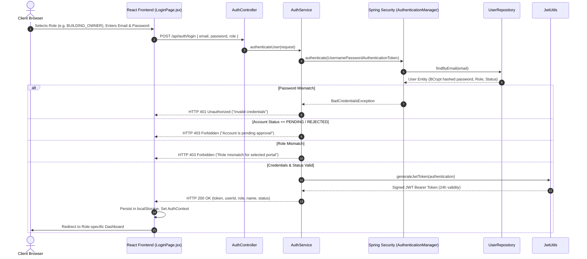
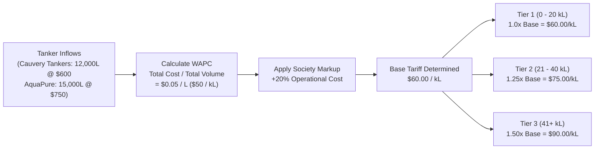
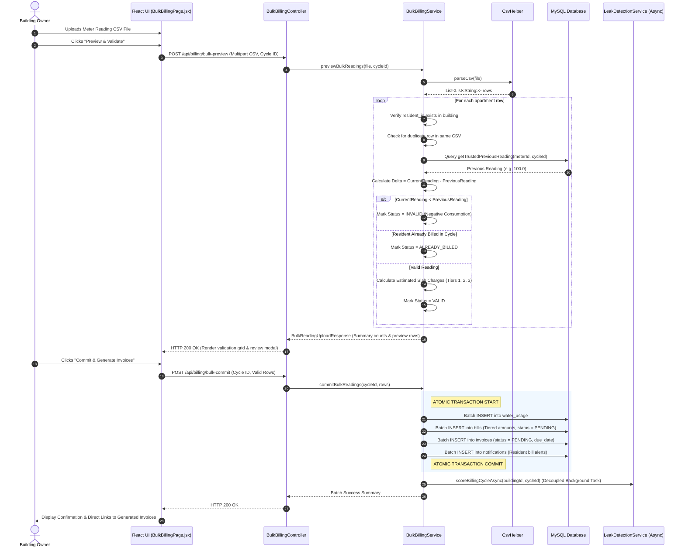
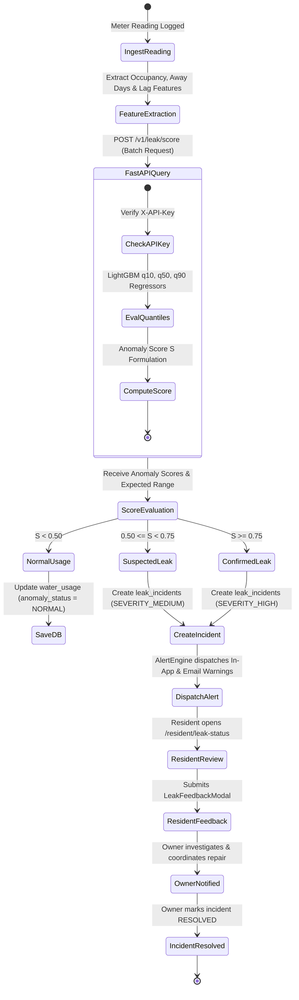
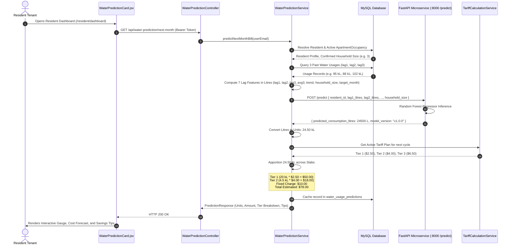
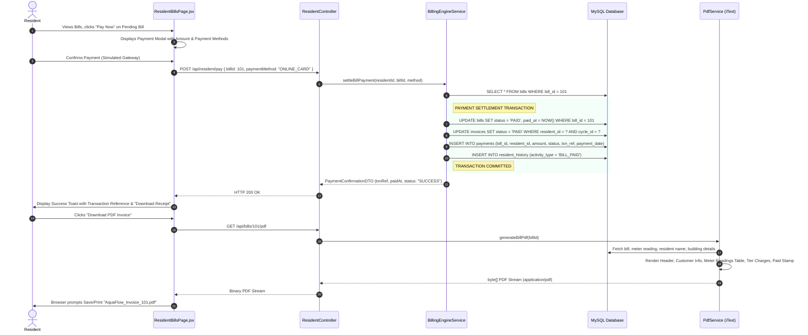

# AquaFlow / AquaTrack: Business Logic, Algorithms & Workflow Diagrams

---

## 1. Authentication & Role-Based Authorization Workflow



---

## 2. Tokenized Resident Invitation & Onboarding Lifecycle

```mermaid
flowchart TD
    Start([Owner Initiates Invitation]) --> Step1[Owner selects Building & Apartment]
    Step1 --> Step2[Enters Resident Name, Email & Phone]
    Step2 --> PostReq[POST /api/residents/invite]
    PostReq --> CheckOccupancy{Apartment currently occupied?}
    
    CheckOccupancy -- Yes --> ErrOcc[Throw 400 Bad Request: Flat Already Occupied]
    CheckOccupancy -- No --> GenToken[Generate Cryptographic UUID Token]
    
    GenToken --> SaveInvite[INSERT resident_invitations: status = PENDING, expires_at = +7 Days]
    SaveInvite --> SaveRes[INSERT residents: invitation_status = PENDING, account_status = INACTIVE]
    SaveRes --> LogAudit[INSERT resident_history: RESIDENT_INVITED]
    LogAudit --> ReturnLink[Return Tokenized URL: /accept-invitation?token=UUID]
    
    ReturnLink --> EmailSim[Email dispatched to Resident Inbox]
    EmailSim --> ResClicks[Resident opens link in browser]
    ResClicks --> GetDetails[GET /api/residents/invitation-details?token=UUID]
    GetDetails --> ShowReview[UI displays Building, Flat #, and Unit Type]
    
    ShowReview --> ResInputs[Resident sets password & clicks Confirm]
    ResInputs --> PostAccept[POST /api/auth/accept-invitation]
    
    PostAccept --> CheckExpiry{Token valid & unexpired?}
    CheckExpiry -- Expired/Invalid --> ErrExp[Throw 400: Invitation Expired]
    CheckExpiry -- Valid --> CreateUser[INSERT users: role = RESIDENT, status = ACTIVE]
    CreateUser --> LinkRes[UPDATE residents: user_id = user.id, status = ACTIVE, accepted_at = NOW()]
    LinkRes --> UpdateInvite[UPDATE resident_invitations: status = ACCEPTED]
    UpdateInvite --> CreateOcc[INSERT apartment_occupancies: status = ACTIVE, start_date = NOW()]
    CreateOcc --> IssueJWT[Generate JWT Session Token]
    IssueJWT --> Finish([Resident redirected to Resident Dashboard])
```

---

## 3. Dynamic Tanker Procurement Tariff Plan Engine

### 3.1 Business Algorithm & Mathematical Formulation
Traditional water billing systems utilize static rates that fail to reflect fluctuating water tanker procurement expenses. AquaFlow introduces a dynamic, formulaic tariff engine.

#### Step 1: Aggregate Cycle Procurement
During an active billing cycle $C$, multiple water tanker purchases $P_1, P_2, \dots, P_n$ are recorded:
$$\text{Total Volume } (V_{\text{total}}) = \sum_{i=1}^{n} \text{Volume}_i \quad (\text{in Litres or kL})$$
$$\text{Total Procurement Cost } (K_{\text{total}}) = \sum_{i=1}^{n} \text{TotalCost}_i \quad (\text{in Currency Units})$$

#### Step 2: Weighted Average Procurement Cost ($WAPC$)
$$WAPC = \begin{cases} 
\frac{K_{\text{total}}}{V_{\text{total}}}, & \text{if } V_{\text{total}} > 0 \\
0.00, & \text{if zero tanker purchases}
\end{cases}$$

#### Step 3: Base Tariff with Society Maintenance Markup
Building owners define a society maintenance markup percentage $M$ (default $20.0\%$):
$$\text{Markup Multiplier} = 1 + \frac{M}{100}$$
$$\text{Base Tariff} = WAPC \times \text{Markup Multiplier}$$

#### Step 4: Tier Multipliers & Bracket Apportioning
To incentivize water conservation, progressive consumption multipliers are applied:
- **Tier 1 (Base Lifeline: $0 - 20\text{ kL}$)**: Multiplier $= 1.00 \times \text{Base Tariff}$ (Fallback floor: \$2.50 / kL)
- **Tier 2 (Standard Usage: $21 - 40\text{ kL}$)**: Multiplier $= 1.25 \times \text{Base Tariff}$ (Fallback floor: \$4.00 / kL)
- **Tier 3 (High Consumption: $41+\text{ kL}$)**: Multiplier $= 1.50 \times \text{Base Tariff}$ (Fallback floor: \$6.00 / kL)



---

## 4. Automated Bulk Billing & CSV Ingestion Pipeline



---

## 5. Machine Learning Quantile Leak Anomaly Radar

### 5.1 Quantile Anomaly Formulation
The LightGBM quantile regression engine predicts conditional consumption distributions:
- $q_{0.10}(x)$: Expected lower consumption bound.
- $q_{0.50}(x)$: Expected median consumption for the household.
- $q_{0.90}(x)$: Expected upper consumption boundary given household parameters.

Feature vector $x$:
$$x = [\text{HouseholdSize}, \text{AwayDays}, \text{UnitTypeFloorFactor}, \text{Lag1Usage}, \text{Lag2Usage}, \text{Avg3Rolling}, \text{PerCapitaConsumption}]$$

If actual units $U$ exceed the upper quantile boundary $q_{0.90}$:
$$\text{Anomaly Score } S = \min\left(1.0, \frac{U - q_{0.90}}{\max(q_{0.90} - q_{0.50}, 1.0)}\right)$$



---

## 6. AI Next-Month Consumption & Cost Forecasting Workflow



---

## 7. Online Bill Payment & PDF Invoice Settlement Flow


