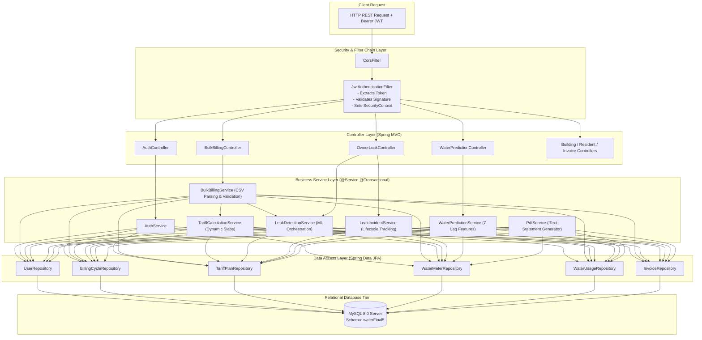
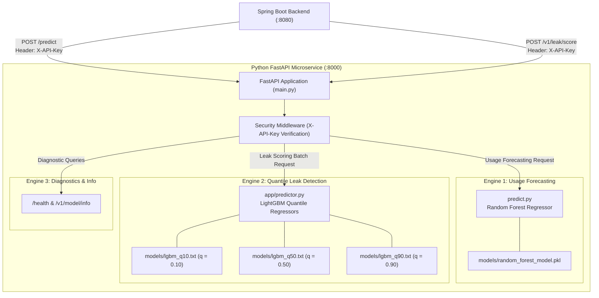
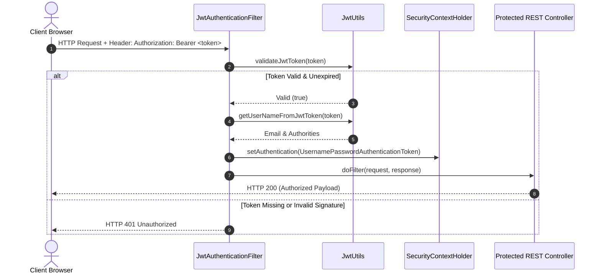

# AquaFlow / AquaTrack: Complete Technical Architecture & Codebase Analysis

---

## 1. Complete Codebase Structure & Directory Layout

The repository is structured into a clean monorepo architecture separating the user interface, backend business logic, database migrations, and machine learning microservice:

```text
E:\REP-Fianl-1-review-2\
├── backend/                             # Java 17 / Spring Boot 3 Backend Server
│   ├── src/
│   │   ├── main/
│   │   │   ├── java/com/smartwater/billing/
│   │   │   │   ├── SmartWaterApplication.java           # Spring Boot bootstrap application entrypoint
│   │   │   │   ├── common/                              # Cross-cutting foundational modules
│   │   │   │   │   ├── config/                          # Security, JWT, CORS, OpenAPI & Data Initializer
│   │   │   │   │   ├── controller/                      # Auth, User, and Bill base REST controllers
│   │   │   │   │   ├── dto/                             # Shared DTOs (Auth, Billing, Dashboard, Leak, Usage)
│   │   │   │   │   ├── entity/                          # Core JPA entities (User, Bill, Usage, Meter, etc.)
│   │   │   │   │   ├── exception/                       # Global Exception Handler & Custom Exceptions
│   │   │   │   │   ├── ml/                              # Spring Boot ML Client & Leak Detection Coordinator
│   │   │   │   │   ├── prediction/                      # Consumption Forecasting Client, Controller & Service
│   │   │   │   │   ├── repository/                      # Common Spring Data JPA repositories
│   │   │   │   │   ├── scheduler/                       # Background alerting and cron schedulers
│   │   │   │   │   ├── service/                         # AuthService, BillingEngine, PdfService, AlertEngine
│   │   │   │   │   └── util/                            # CSV Helper and cryptographic token utilities
│   │   │   │   ├── owner/                               # Building Owner Domain Modules
│   │   │   │   │   ├── controller/                      # Buildings, Residents, Invoices, Billing, Leaks, Tariff
│   │   │   │   │   ├── dto/                             # Owner DTOs (Apartments, Buildings, BulkBilling, etc.)
│   │   │   │   │   ├── entity/                          # Building, Apartment, TariffPlan, WaterPurchase, etc.
│   │   │   │   │   ├── repository/                      # Owner domain Spring Data repositories
│   │   │   │   │   └── service/                         # BulkBilling, TariffCalculation, WaterPurchase, etc.
│   │   │   │   ├── resident/                            # Resident Domain Modules
│   │   │   │   │   ├── controller/                      # Resident, Occupancy, Household, Notification APIs
│   │   │   │   │   ├── dto/                             # Resident, Household, Occupancy DTOs
│   │   │   │   │   ├── entity/                          # Resident, ApartmentOccupancy, AwayPeriod, etc.
│   │   │   │   │   ├── repository/                      # Resident domain Spring Data repositories
│   │   │   │   │   └── service/                         # ResidentService, OccupancyService, HouseholdService
│   │   │   │   └── superadmin/                          # Super Admin Domain Modules
│   │   │   │       ├── controller/                      # SuperAdminController (approvals, metrics, logs)
│   │   │   │       └── service/                         # SuperAdminService
│   │   │   └── resources/
│   │   │       ├── application.yml                      # Primary Spring Boot configuration
│   │   │       └── db/migration/                        # Versioned SQL migration scripts (V1 through V12)
│   │   └── test/                                        # JUnit 5 & Mockito test suites
│   ├── pom.xml                                          # Maven project descriptor & dependencies
│   └── seed_clean_sample_data.sql                       # Clean sample database seed script
├── frontend/                            # React 19 / Vite Single Page Application
│   ├── index.html                                       # Single Page HTML host template
│   ├── package.json                                     # NPM dependencies & build scripts
│   ├── vite.config.js                                   # Vite configuration & /api reverse proxy
│   └── src/
│       ├── main.jsx                                     # React DOM bootstrap entrypoint
│       ├── App.jsx                                      # Top-level React Router layout & route definitions
│       ├── index.css                                    # Global styling, AquaFlow CSS design tokens
│       ├── shared/                                      # Shared components, layout, context, and auth
│       │   ├── auth/                                    # LandingPage, LoginPage, RegisterOwner, RegisterResident
│       │   ├── components/                              # Navbar, Sidebar, StatCard, LoadingSpinner, Modals
│       │   ├── context/                                 # AuthContext (JWT management & session state)
│       │   ├── layouts/                                 # PublicLayout & DashboardLayout (RBAC guarded)
│       │   ├── pages/                                   # Shared ProfilePage
│       │   └── services/                                # Axios instance (`api.js`) with request interceptor
│       ├── superadmin/                                  # Super Admin dashboard, owner approvals & audit pages
│       ├── owner/                                       # Building Owner management pages (11 specialized pages)
│       └── resident/                                    # Resident self-service portal pages (7 pages)
├── ml-service/                          # Python 3.14 / FastAPI Unified AI Microservice
│   ├── main.py                                          # FastAPI application entrypoint & routing
│   ├── requirements.txt                                 # Python dependencies (FastAPI, LightGBM, scikit-learn)
│   ├── app/
│   │   ├── config.py                                    # Environment settings & API keys
│   │   ├── predictor.py                                 # LightGBM Quantile Leak Predictor class
│   │   ├── schemas.py                                   # Pydantic V2 Request & Response schemas
│   │   ├── features.py                                  # Feature extraction & matrix transformation
│   │   └── security.py                                  # API key header verification middleware
│   ├── models/                                          # Serialized models (.pkl and LightGBM binaries)
│   │   ├── random_forest_model.pkl                      # Trained Random Forest regressor for usage forecasting
│   │   ├── lgbm_q10.txt                                 # LightGBM 10th percentile quantile model
│   │   ├── lgbm_q50.txt                                 # LightGBM 50th percentile (median) quantile model
│   │   └── lgbm_q90.txt                                 # LightGBM 90th percentile quantile model
│   ├── training/                                        # Model training pipeline scripts
│   └── tests/                                           # Pytest test cases
├── project_documentation/               # Exhaustive documentation & analysis suite
│   ├── screenshots/                                     # High-res actual screenshots organized by role
│   │   ├── public/                                      # Landing, Login, and Registration screenshots
│   │   ├── superadmin/                                  # Admin Dashboard, Approvals, and Audit screenshots
│   │   ├── owner/                                       # Buildings, Residents, Billing, Invoices, Leaks
│   │   └── resident/                                    # Resident Dashboard, Bills, Leaks, Predictions
│   └── scripts/                                         # Automated test and capture scripts
├── seed_clean_test_data.sql                             # Master clean MySQL seed script for testing
└── README.md                                            # Repository summary and quickstart
```

---

## 2. Frontend Architecture & Design Patterns

### 2.1 Component Hierarchy & Tree Structure
The frontend application uses a clean hierarchy built on top of **React 19** and **React Router DOM v7**:

```text
<AuthProvider>
  <BrowserRouter>
    <Routes>
      {/* Public Pages */}
      <Route element={<PublicLayout />}>
        ├── / (LandingPage)
        ├── /login (LoginPage - 3-Role Toggle)
        ├── /register-owner (RegisterOwnerPage)
        ├── /register-resident (RegisterResidentPage)
        └── /accept-invitation (AcceptInvitationPage)
      </Route>
      
      {/* Super Admin Guarded Routes */}
      <Route element={<DashboardLayout allowedRole="SUPER_ADMIN" />}>
        ├── /admin/dashboard (AdminDashboard)
        ├── /admin/owners (AdminOwnersPage)
        ├── /admin/pending-owners (AdminPendingOwnersPage)
        ├── /admin/history (AdminHistoryPage)
        └── /admin/profile (ProfilePage)
      </Route>
      
      {/* Building Owner Guarded Routes */}
      <Route element={<DashboardLayout allowedRole="BUILDING_OWNER" />}>
        ├── /owner/dashboard (OwnerDashboard)
        ├── /owner/buildings (OwnerBuildingsPage)
        ├── /owner/residents (OwnerResidentsPage)
        ├── /owner/usage (OwnerUsagePage)
        ├── /owner/usage-comparison (OwnerUsageComparisonPage)
        ├── /owner/billing (OwnerBillingPage)
        ├── /owner/bulk-billing (BulkBillingPage)
        ├── /owner/invoices (InvoicesPage)
        ├── /owner/history (OwnerHistoryPage)
        ├── /owner/leak-monitoring (OwnerLeakMonitoringPage)
        └── /owner/profile (ProfilePage)
      </Route>
      
      {/* Resident Guarded Routes */}
      <Route element={<DashboardLayout allowedRole="RESIDENT" />}>
        ├── /resident/dashboard (ResidentDashboard)
        │     └── <WaterPredictionCard />
        ├── /resident/leak-status (ResidentLeakStatusPage)
        │     └── <LeakFeedbackModal />
        ├── /resident/bills (ResidentBillsPage)
        ├── /resident/comparison (ResidentComparisonPage)
        ├── /resident/notifications (ResidentNotificationsPage)
        └── /resident/profile (ProfilePage)
              ├── <HouseholdSizeModal />
              └── <AwayPeriodModal />
      </Route>
    </Routes>
  </BrowserRouter>
</AuthProvider>
```

### 2.2 Global State & Session Management (`AuthContext.jsx`)
- State stored: `user` object containing `{ token, type, userId, name, email, role, status, phone }`.
- Persisted in browser `localStorage` as `'user'`.
- Upon initial component mount, reads `localStorage.getItem('user')` and sets initial state.
- Exposes helper methods:
  - `login(email, password, role)`: Calls `POST /api/auth/login`. On HTTP 200, sets context state and writes to `localStorage`.
  - `logout()`: Clears `localStorage` and resets `user` to `null`.
  - `isAuthenticated`: Evaluates `Boolean(user && user.token)`.

### 2.3 HTTP Interceptor Layer (`api.js`)
- Configured using **Axios**:
  ```javascript
  const api = axios.create({
    baseURL: '/api',
    headers: { 'Content-Type': 'application/json' }
  });
  ```
- **Request Interceptor**: Automatically intercepts every outgoing request. If `user.token` exists in `localStorage`, it attaches the HTTP authorization header:
  ```http
  Authorization: Bearer <jwt_token>
  ```
- **Response Interceptor**: Automatically catches HTTP 401 Unauthorized errors and prompts session expiration/redirect to `/login`.

### 2.4 Role-Based Route Guarding (`DashboardLayout.jsx`)
- Wraps all protected views with `<Navbar />` and `<Sidebar />`.
- Evaluates `allowedRole`:
  - If user is not authenticated $\rightarrow$ navigates to `/login`.
  - If authenticated user role does not match `allowedRole` $\rightarrow$ redirects to the user's appropriate portal dashboard or root.

---

## 3. Backend Architecture & Design Patterns

### 3.1 Layered Architecture Pattern
The backend adheres strictly to enterprise layered domain-driven principles:



### 3.2 DTO Transformations & Validation
- Clean separation between JPA Database Entities and API payloads.
- Validation using `jakarta.validation.constraints` (`@NotNull`, `@NotBlank`, `@Email`, `@Min`, `@DecimalMin`).
- Custom DTOs enforce immutable data contracts:
  - `AuthDTOs.LoginRequest`, `AuthDTOs.AuthResponse`
  - `BulkBillingDTOs.BulkReadingUploadResponse`, `BulkBillingDTOs.BulkReadingRowDTO`
  - `BillingEngineDTOs.TariffPlanDTO`, `BillingEngineDTOs.BillingCycleDTO`
  - `LeakDTOs.MlScoreRequest`, `LeakDTOs.MlScoreResponse`, `LeakDTOs.IncidentDetailDTO`
  - `PredictionDTOs.PredictionResponse`, `PredictionDTOs.FastApiPredictRequest`

### 3.3 Asynchronous Execution & Microservice Resilience
- **Asynchronous ML Scoring**: Leak anomaly detection is decoupled from user batch import using Spring's `@Async`:
  ```java
  @Async
  public CompletableFuture<Void> scoreBillingCycleAsync(Long buildingId, Long cycleId)
  ```
  This ensures that uploading meter readings CSV is instantaneous and does not block on Python HTTP latency.
- **Fail-Safe Statistical Fallbacks**: Both `MlClient` and `PredictionMlClient` implement timeout guards ($5000\text{ms}$) and connection health checks. If the Python microservice is offline, the backend automatically falls back to statistical baseline analytics ($\mu + 2\sigma$), ensuring zero business disruption.

---

## 4. Machine Learning Microservice Architecture

The ML microservice is built using **FastAPI** and **Python 3.14**, running as a stand-alone microservice on port `8000`:



### 4.1 Consumption Forecasting Engine (`/predict`)
- **Algorithm**: Random Forest Regressor trained on longitudinal apartment consumption data.
- **Inputs**:
  - `lag1_litres`, `lag2_litres`, `lag3_litres`: Consumption readings from the preceding 3 billing periods.
  - `avg3_litres`: 3-month moving average consumption.
  - `trend_litres`: Consumption delta ($\text{lag}_1 - \text{lag}_3$) identifying accelerating usage.
  - `household_size`: Confirmed occupancy headcount.
  - `target_month`: Integer month ($1-12$) capturing seasonal environmental variations.
- **Output**: Forecasted consumption in Litres, model version, and inference timestamp.

### 4.2 Quantile Leak Anomaly Radar (`/v1/leak/score`)
- **Algorithm**: Gradient Boosted Quantile Decision Trees (LightGBM).
- **Percentile Thresholds**:
  - $q_{0.10}$ (Lower Expected Bound): Minimum expected usage considering baseline occupancy.
  - $q_{0.50}$ (Expected Median): Normal consumption midpoint.
  - $q_{0.90}$ (Upper Expected Bound): 90th percentile ceiling for standard occupancy usage.
- **Anomaly Scoring Formulation**:
  $$Score = \min\left(1.0, \frac{\text{Current Units} - q_{0.90}}{\max(q_{0.90} - q_{0.50}, 1.0)}\right)$$
- **Classification Rules**:
  - $Score \ge 0.75 \rightarrow \mathbf{CONFIRMED\_LEAK}$ (High probability continuous leak)
  - $0.50 \le Score < 0.75 \rightarrow \mathbf{SUSPECTED\_LEAK}$ (Moderate probability anomaly)
  - $Score < 0.50 \rightarrow \mathbf{NORMAL}$ (Standard consumption)
  - Spike without baseline $\rightarrow \mathbf{ANOMALOUS\_SPIKE}$

---

## 5. Security & Authentication Architecture

### 5.1 Authentication Flow
1. User provides credentials (`email`, `password`) and selected `role` on the frontend login interface.
2. Frontend dispatches `POST /api/auth/login`.
3. `AuthController` delegates to `AuthService.authenticate()`.
4. `AuthenticationManager` invokes `CustomUserDetailsService` to verify hashed credentials using **BCrypt**.
5. Upon successful authentication, `JwtUtils.generateJwtToken()` generates an HMAC-SHA256 signed token embedding:
   - `sub`: User email address
   - `role`: Granted role (`SUPER_ADMIN`, `BUILDING_OWNER`, `RESIDENT`)
   - `iat`: Issue timestamp
   - `exp`: Expiration timestamp ($24\text{ hours} = 86,400,000\text{ ms}$)
6. Spring Boot returns `AuthResponse` containing token, user ID, full name, role, and approval status.
7. Frontend stores token in `localStorage` and injects it into all future Axios requests.

### 5.2 Authorization & Filter Pipeline

