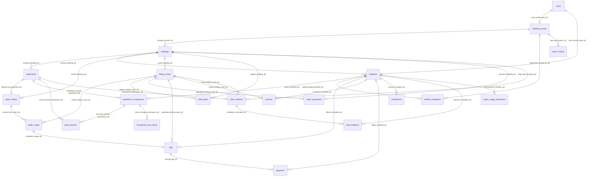

# AquaFlow / AquaTrack: Database Schema & Entity-Relationship Architecture

---

## 1. Complete Entity-Relationship (ER) Diagram

---

## 2. Table-by-Table Technical Data Dictionary

The platform database `waterFinal5` consists of **25 relational tables** supporting ACID-compliant transactional utility billing:

### Category A: Identity, Authentication & Governance

#### 1. `users`
- **Purpose**: System-wide authentication entity storing credentials, role designations, and approval statuses.
- **Primary Key**: `user_id` (BIGINT AUTO_INCREMENT)
- **Columns**:
  - `name` (VARCHAR 100, NOT NULL): Full legal name.
  - `email` (VARCHAR 150, UNIQUE, NOT NULL): Login username and email address.
  - `password` (VARCHAR 255, NOT NULL): BCrypt hashed password string.
  - `role` (VARCHAR 50, NOT NULL): System role (`SUPER_ADMIN`, `BUILDING_OWNER`, `RESIDENT`).
  - `status` (VARCHAR 50, NOT NULL): User status (`APPROVED`, `PENDING`, `REJECTED`, `ACTIVE`, `INACTIVE`).
  - `created_at` (TIMESTAMP DEFAULT CURRENT_TIMESTAMP): Account registration timestamp.

#### 2. `building_owners`
- **Purpose**: Profile entity for commercial property managers and building owners.
- **Primary Key**: `owner_id` (BIGINT AUTO_INCREMENT)
- **Foreign Keys**: `user_id` REFERENCES `users(user_id)` ON DELETE CASCADE
- **Columns**:
  - `name` (VARCHAR 100, NOT NULL): Property owner or company name.
  - `phone` (VARCHAR 20, NOT NULL): Primary contact phone.
  - `approval_status` (VARCHAR 50, NOT NULL DEFAULT 'PENDING'): Super Admin verification status (`PENDING`, `APPROVED`, `REJECTED`).
  - `created_at` (TIMESTAMP DEFAULT CURRENT_TIMESTAMP).

#### 3. `residents`
- **Purpose**: Profile entity representing apartment tenant residents.
- **Primary Key**: `resident_id` (BIGINT AUTO_INCREMENT)
- **Foreign Keys**:
  - `user_id` REFERENCES `users(user_id)` ON DELETE SET NULL
  - `building_id` REFERENCES `buildings(building_id)` ON DELETE CASCADE
- **Columns**:
  - `name` (VARCHAR 100, NOT NULL): Resident full name.
  - `email` (VARCHAR 150, NOT NULL): Contact email address.
  - `phone` (VARCHAR 20, NOT NULL): Contact mobile number.
  - `apartment_number` (VARCHAR 20, NOT NULL): Physical flat/door number.
  - `invitation_token` (VARCHAR 255): Cryptographic invitation UUID.
  - `invitation_status` (VARCHAR 50, NOT NULL DEFAULT 'PENDING'): (`PENDING`, `ACCEPTED`, `EXPIRED`).
  - `account_status` (VARCHAR 50, NOT NULL DEFAULT 'INACTIVE'): (`INACTIVE`, `ACTIVE`).
  - `created_at` (TIMESTAMP DEFAULT CURRENT_TIMESTAMP).
  - `accepted_at` (TIMESTAMP NULL): Invitation confirmation timestamp.

#### 4. `resident_invitations`
- **Purpose**: Cryptographically secured invitation dispatch ledger.
- **Primary Key**: `id` (BIGINT AUTO_INCREMENT)
- **Foreign Keys**:
  - `resident_id` REFERENCES `residents(resident_id)` ON DELETE CASCADE
  - `invited_by_id` REFERENCES `building_owners(owner_id)` ON DELETE CASCADE
- **Columns**:
  - `token` (VARCHAR 255, UNIQUE, NOT NULL): UUID authorization token.
  - `status` (VARCHAR 50, NOT NULL DEFAULT 'PENDING'): Invitation state.
  - `expires_at` (TIMESTAMP NOT NULL): 7-day expiration boundary.
  - `accepted_at` (TIMESTAMP NULL).
  - `created_at` (TIMESTAMP DEFAULT CURRENT_TIMESTAMP).

---

### Category B: Physical Estate & Sub-Meter Infrastructure

#### 5. `buildings`
- **Purpose**: Physical residential properties managed by building owners.
- **Primary Key**: `building_id` (BIGINT AUTO_INCREMENT)
- **Foreign Keys**: `owner_id` REFERENCES `building_owners(owner_id)` ON DELETE CASCADE
- **Columns**:
  - `building_name` (VARCHAR 150, NOT NULL): Display name of building/complex.
  - `building_number` (VARCHAR 50, NOT NULL): Official municipal/property identifier.
  - `total_flats` (INT NOT NULL): Number of physical units.
  - `location` (VARCHAR 255, NOT NULL): Full street address.
  - `created_at` (TIMESTAMP DEFAULT CURRENT_TIMESTAMP).

#### 6. `apartments`
- **Purpose**: Individual residential apartments/flats within a building.
- **Primary Key**: `apartment_id` (BIGINT AUTO_INCREMENT)
- **Foreign Keys**: `building_id` REFERENCES `buildings(building_id)` ON DELETE CASCADE
- **Columns**:
  - `floor_number` (INT NOT NULL): Physical floor.
  - `apartment_name` (VARCHAR 100, NOT NULL): Formatted name (e.g. "Apartment 101").
  - `room_number` (VARCHAR 50, NOT NULL): Room/flat identifier (e.g. "101").
  - `unit_type` (VARCHAR 50, NOT NULL): Architectural type (`1BHK`, `2BHK`, `3BHK`, `PENTHOUSE`, `STUDIO`).
  - `description` (VARCHAR 255): Descriptive metadata.
  - `created_at` (TIMESTAMP DEFAULT CURRENT_TIMESTAMP).

#### 7. `water_meters`
- **Purpose**: Digital sub-meters tracking water flow for specific apartments or common areas.
- **Primary Key**: `meter_id` (BIGINT AUTO_INCREMENT)
- **Foreign Keys**:
  - `building_id` REFERENCES `buildings(building_id)` ON DELETE CASCADE
  - `resident_id` REFERENCES `residents(resident_id)` ON DELETE SET NULL
  - `apartment_id` REFERENCES `apartments(apartment_id)` ON DELETE SET NULL
- **Columns**:
  - `meter_number` (VARCHAR 50, UNIQUE, NOT NULL): Serial identifier (`WM-B-101-101`).
  - `installation_date` (DATE NOT NULL): Commissioning date.
  - `status` (VARCHAR 50, NOT NULL DEFAULT 'ACTIVE'): Meter operational status (`ACTIVE`, `MAINTENANCE`, `DECOMMISSIONED`).

---

### Category C: Occupancy Dynamics & Resident Profile

#### 8. `apartment_occupancies`
- **Purpose**: Tracks occupancy tenancy windows, household demographics, and ground-truth occupants for ML feature engineering.
- **Primary Key**: `occupancy_id` (BIGINT AUTO_INCREMENT)
- **Foreign Keys**:
  - `apartment_id` REFERENCES `apartments(apartment_id)` ON DELETE CASCADE
  - `resident_id` REFERENCES `residents(resident_id)` ON DELETE CASCADE
- **Columns**:
  - `start_date` (DATETIME NOT NULL): Tenancy commencement.
  - `end_date` (DATETIME NULL): Tenancy termination date.
  - `status` (VARCHAR 50, NOT NULL DEFAULT 'ACTIVE'): (`ACTIVE`, `INACTIVE`).
  - `household_size` (INT NOT NULL DEFAULT 3): Confirmed occupant count.
  - `children_count` (INT NOT NULL DEFAULT 0): Child occupant count.
  - `household_size_source` (VARCHAR 50): Source (`RESIDENT_ONBOARDING`, `DEFAULT_UNIT_TYPE`, `MANUAL_OVERRIDE`).
  - `household_size_confirmed` (TINYINT(1) DEFAULT 1).
  - `created_at` (TIMESTAMP DEFAULT CURRENT_TIMESTAMP).

#### 9. `away_periods`
- **Purpose**: Logs resident-declared vacation/travel periods where apartment should have near-zero water draw.
- **Primary Key**: `id` (BIGINT AUTO_INCREMENT)
- **Foreign Keys**:
  - `apartment_id` REFERENCES `apartments(apartment_id)`
  - `occupancy_id` REFERENCES `apartment_occupancies(occupancy_id)`
- **Columns**:
  - `start_date` (DATE NOT NULL): Travel departure date.
  - `end_date` (DATE NOT NULL): Return date.
  - `notes` (VARCHAR 255): Resident travel description.
  - `created_at` (TIMESTAMP DEFAULT CURRENT_TIMESTAMP).

#### 10. `household_size_history`
- **Purpose**: Historical audit of household occupancy modifications.
- **Primary Key**: `id` (BIGINT AUTO_INCREMENT)
- **Foreign Keys**: `occupancy_id` REFERENCES `apartment_occupancies(occupancy_id)`
- **Columns**:
  - `previous_size` (INT NOT NULL): Previous headcount.
  - `new_size` (INT NOT NULL): Updated headcount.
  - `reason` (VARCHAR 255): Reason for headcount change.
  - `changed_at` (TIMESTAMP DEFAULT CURRENT_TIMESTAMP).

#### 11. `occupancy_requests`
- **Purpose**: Formal requests submitted by residents requesting occupancy adjustments.
- **Primary Key**: `id` (BIGINT AUTO_INCREMENT)
- **Foreign Keys**: `resident_id` REFERENCES `residents(resident_id)`
- **Columns**:
  - `requested_size` (INT NOT NULL).
  - `status` (VARCHAR 50 DEFAULT 'PENDING').
  - `review_notes` (VARCHAR 255).
  - `created_at` (TIMESTAMP DEFAULT CURRENT_TIMESTAMP).

---

### Category D: Billing Cycles, Tanker Procurement & Tariffs

#### 12. `billing_cycles`
- **Purpose**: Monthly billing scoping entity defining cycle windows and statuses.
- **Primary Key**: `id` (BIGINT AUTO_INCREMENT)
- **Foreign Keys**: `building_id` REFERENCES `buildings(building_id)` ON DELETE CASCADE
- **Columns**:
  - `billing_month` (DATE NOT NULL): First day of billing month (e.g. `2026-10-01`).
  - `start_date` (DATE NOT NULL): Cycle start date.
  - `end_date` (DATE NOT NULL): Cycle end date.
  - `status` (VARCHAR 50 NOT NULL DEFAULT 'OPEN'): (`OPEN`, `FINALIZED`, `LOCKED`).
  - `created_at` (DATETIME NOT NULL).

#### 13. `tariff`
- **Purpose**: Legacy / Baseline static tariff brackets.
- **Primary Key**: `tariff_id` (BIGINT AUTO_INCREMENT)
- **Columns**:
  - `minimum_units` (DOUBLE NOT NULL): Slab start.
  - `maximum_units` (DOUBLE NOT NULL): Slab end.
  - `price_per_unit` (DOUBLE NOT NULL): Charge per unit.
  - `fixed_charge` (DOUBLE NOT NULL): Base fixed charge.

#### 14. `tariff_plans`
- **Purpose**: Dynamic procurement-indexed 3-tier tariff plans generated for specific billing cycles.
- **Primary Key**: `id` (BIGINT AUTO_INCREMENT)
- **Foreign Keys**:
  - `building_id` REFERENCES `buildings(building_id)`
  - `billing_cycle_id` REFERENCES `billing_cycles(id)`
- **Columns**:
  - `average_procurement_cost` (DECIMAL(10,2) NOT NULL): Weighted average tanker cost ($WAPC$).
  - `markup_percentage` (DECIMAL(5,2) NOT NULL DEFAULT 20.00): Society maintenance markup.
  - `base_tariff` (DECIMAL(10,2) NOT NULL): Base rate ($WAPC \times (1 + \text{markup})$).
  - `tier1_limit` (DECIMAL(10,2) DEFAULT 20.00): Tier 1 threshold ($0-20\text{ kL}$).
  - `tier1_rate` (DECIMAL(10,2) NOT NULL): Tier 1 rate per kL.
  - `tier1_multiplier` (DECIMAL(4,2) DEFAULT 1.00).
  - `tier2_limit` (DECIMAL(10,2) DEFAULT 40.00): Tier 2 threshold ($21-40\text{ kL}$).
  - `tier2_rate` (DECIMAL(10,2) NOT NULL): Tier 2 rate per kL.
  - `tier2_multiplier` (DECIMAL(4,2) DEFAULT 1.25).
  - `tier3_rate` (DECIMAL(10,2) NOT NULL): Tier 3 rate per kL.
  - `tier3_multiplier` (DECIMAL(4,2) DEFAULT 1.50).
  - `fixed_charge` (DECIMAL(10,2) DEFAULT 50.00).
  - `status` (VARCHAR 50 NOT NULL DEFAULT 'ACTIVE'): (`ACTIVE`, `EXPIRED`, `LOCKED`).
  - `effective_from` (DATE NOT NULL).
  - `created_at` (DATETIME NOT NULL).

#### 15. `water_purchases`
- **Purpose**: Supplemental private water tanker delivery logs.
- **Primary Key**: `id` (BIGINT AUTO_INCREMENT)
- **Foreign Keys**:
  - `building_id` REFERENCES `buildings(building_id)`
  - `billing_cycle_id` REFERENCES `billing_cycles(id)`
- **Columns**:
  - `purchase_date` (DATE NOT NULL): Delivery date.
  - `supplier` (VARCHAR(150) NOT NULL): Vendor name (e.g. "Cauvery Tankers").
  - `quantity` / `volume` (DECIMAL(12,2) NOT NULL): Volume delivered in Litres.
  - `unit_cost` (DECIMAL(10,4) NOT NULL): Cost per Litre.
  - `total_cost` (DECIMAL(12,2) NOT NULL): Invoiced tanker amount.
  - `created_at` (TIMESTAMP DEFAULT CURRENT_TIMESTAMP).

---

### Category E: Water Metering, Invoicing & Payments

#### 16. `water_usage`
- **Purpose**: Monthly sub-meter consumption readings and ML anomaly audit scores.
- **Primary Key**: `usage_id` (BIGINT AUTO_INCREMENT)
- **Foreign Keys**:
  - `meter_id` REFERENCES `water_meters(meter_id)` ON DELETE CASCADE
  - `billing_cycle_id` REFERENCES `billing_cycles(id)` ON DELETE SET NULL
- **Columns**:
  - `month` (INT NOT NULL): Month integer ($1-12$).
  - `year` (INT NOT NULL): Year integer (e.g. $2026$).
  - `previous_reading` (DOUBLE NOT NULL): Starting meter counter.
  - `current_reading` (DOUBLE NOT NULL): Closing meter counter.
  - `units_consumed` (DOUBLE NOT NULL): Net consumption ($\text{Current} - \text{Previous}$).
  - `recorded_at` (TIMESTAMP DEFAULT CURRENT_TIMESTAMP).
  - `anomaly_score` (DOUBLE NULL): ML anomaly score ($0.0 - 1.0$).
  - `anomaly_status` (VARCHAR 50 NULL): Status (`NORMAL`, `SUSPECTED_LEAK`, `CONFIRMED_LEAK`, `ANOMALOUS_SPIKE`).
  - `anomaly_reason` (VARCHAR 255 NULL): Rationale description.
  - `expected_min` / `expected_max` (DOUBLE NULL): LightGBM $q_{10}$ and $q_{90}$ boundaries.
  - `incident_id` (BIGINT NULL): Associated leak incident reference.
  - `scored_at` (DATETIME NULL): ML scoring timestamp.

#### 17. `bills`
- **Purpose**: Financial water utility billing record detailing tiered slab apportionments.
- **Primary Key**: `bill_id` (BIGINT AUTO_INCREMENT)
- **Foreign Keys**:
  - `resident_id` REFERENCES `residents(resident_id)` ON DELETE CASCADE
  - `billing_cycle_id` REFERENCES `billing_cycles(id)` ON DELETE CASCADE
  - `usage_id` REFERENCES `water_usage(usage_id)` ON DELETE SET NULL
- **Columns**:
  - `bill_month` (INT NOT NULL), `bill_year` (INT NOT NULL).
  - `units` (DOUBLE NOT NULL): Total units billed.
  - `amount` (DOUBLE NOT NULL): Total payable amount.
  - `status` (VARCHAR 50 NOT NULL DEFAULT 'PENDING'): (`PENDING`, `PAID`, `OVERDUE`).
  - `due_date` (DATE NOT NULL): Due date.
  - `generated_at` (TIMESTAMP DEFAULT CURRENT_TIMESTAMP).
  - `paid_at` (TIMESTAMP NULL).
  - `tier1_units`, `tier1_rate`, `tier1_amount` (DOUBLE).
  - `tier2_units`, `tier2_rate`, `tier2_amount` (DOUBLE).
  - `tier3_units`, `tier3_rate`, `tier3_amount` (DOUBLE).

#### 18. `invoices`
- **Purpose**: Tax and accounting invoice statement record matching generated bills.
- **Primary Key**: `id` (BIGINT AUTO_INCREMENT)
- **Foreign Keys**:
  - `resident_id` REFERENCES `residents(resident_id)`
  - `billing_cycle_id` REFERENCES `billing_cycles(id)`
- **Columns**:
  - `usage_units` (DECIMAL(10,2) NOT NULL).
  - `base_charge` (DECIMAL(10,2) NOT NULL).
  - `extra_charge` (DECIMAL(10,2) NOT NULL).
  - `shared_water_charge` (DECIMAL(10,2) DEFAULT 0.00).
  - `total_amount` (DECIMAL(10,2) NOT NULL).
  - `status` (VARCHAR 50 NOT NULL DEFAULT 'PENDING').
  - `due_date` (DATE NOT NULL).
  - `created_at` (DATETIME NOT NULL).

#### 19. `payments`
- **Purpose**: Ledger of electronic payments and simulated gateway settlements.
- **Primary Key**: `payment_id` (BIGINT AUTO_INCREMENT)
- **Foreign Keys**:
  - `bill_id` REFERENCES `bills(bill_id)` ON DELETE CASCADE
  - `resident_id` REFERENCES `residents(resident_id)` ON DELETE CASCADE
- **Columns**:
  - `amount` (DOUBLE NOT NULL): Amount paid.
  - `payment_date` (TIMESTAMP DEFAULT CURRENT_TIMESTAMP).
  - `payment_method` (VARCHAR 50 NOT NULL): (`ONLINE_SIMULATED`, `CARD`, `UPI`, `NET_BANKING`).
  - `transaction_reference` (VARCHAR 100 UNIQUE NOT NULL): Unique transaction hash/UUID.
  - `status` (VARCHAR 50 NOT NULL DEFAULT 'SUCCESS'): (`SUCCESS`, `FAILED`, `REFUNDED`).

---

### Category F: AI/ML Leak Detection, Predictions & Audit Logs

#### 20. `leak_incidents`
- **Purpose**: Tracks operational lifecycle of identified water leaks.
- **Primary Key**: `id` (BIGINT AUTO_INCREMENT)
- **Foreign Keys**:
  - `building_id` REFERENCES `buildings(building_id)`
  - `apartment_id` REFERENCES `apartments(apartment_id)`
  - `billing_cycle_id` REFERENCES `billing_cycles(id)`
- **Columns**:
  - `severity` (VARCHAR 50 NOT NULL): (`LOW`, `MEDIUM`, `HIGH`, `CRITICAL`).
  - `status` (VARCHAR 50 NOT NULL DEFAULT 'OPEN'): (`OPEN`, `INVESTIGATING`, `CONFIRMED_LEAK`, `FALSE_POSITIVE`, `RESOLVED`).
  - `anomaly_score` (DOUBLE NOT NULL).
  - `estimated_loss_litres` (DOUBLE DEFAULT 0.0).
  - `resident_feedback` (VARCHAR 50 NULL).
  - `resolution_notes` (VARCHAR 500 NULL).
  - `detected_at` (TIMESTAMP DEFAULT CURRENT_TIMESTAMP).
  - `resolved_at` (TIMESTAMP NULL).

#### 21. `leak_feedback`
- **Purpose**: Resident-submitted feedback regarding flagged consumption anomalies.
- **Primary Key**: `id` (BIGINT AUTO_INCREMENT)
- **Foreign Keys**:
  - `incident_id` REFERENCES `leak_incidents(id)`
  - `resident_id` REFERENCES `residents(resident_id)`
- **Columns**:
  - `feedback_type` (VARCHAR 50 NOT NULL): (`CONFIRMED_LEAK`, `FALSE_POSITIVE`, `GUESTS_VISITING`, `PLUMBING_REPAIRED`).
  - `comments` (VARCHAR 500).
  - `reported_at` (TIMESTAMP DEFAULT CURRENT_TIMESTAMP).

#### 22. `water_usage_predictions`
- **Purpose**: Cached next-month consumption forecasts generated by Random Forest model.
- **Primary Key**: `id` (BIGINT AUTO_INCREMENT)
- **Foreign Keys**: `resident_id` REFERENCES `residents(resident_id)`
- **Columns**:
  - `prediction_month` (INT NOT NULL), `prediction_year` (INT NOT NULL).
  - `predicted_consumption_litres` (DOUBLE NOT NULL).
  - `estimated_amount` (DOUBLE NOT NULL).
  - `confidence_score` (DOUBLE DEFAULT 0.85).
  - `model_version` (VARCHAR 50 DEFAULT 'v1.0.0').
  - `created_at` (TIMESTAMP DEFAULT CURRENT_TIMESTAMP).

#### 23. `notifications`
- **Purpose**: In-app alerts delivered to residents and owners (bills, leaks, approvals).
- **Primary Key**: `notification_id` (BIGINT AUTO_INCREMENT)
- **Foreign Keys**: `resident_id` REFERENCES `residents(resident_id)` ON DELETE CASCADE
- **Columns**:
  - `title` (VARCHAR 150 NOT NULL).
  - `message` (TEXT NOT NULL).
  - `type` (VARCHAR 50 NOT NULL): (`BILL_GENERATED`, `PAYMENT_RECEIVED`, `LEAK_ALERT`, `SYSTEM`).
  - `is_read` (BOOLEAN DEFAULT FALSE).
  - `created_at` (TIMESTAMP DEFAULT CURRENT_TIMESTAMP).

#### 24. `owner_history`
- **Purpose**: Immutable audit log of all building owner registrations, approvals, and events.
- **Primary Key**: `id` (BIGINT AUTO_INCREMENT)
- **Columns**:
  - `owner_id` (BIGINT), `owner_name` (VARCHAR 150), `email` (VARCHAR 150), `phone` (VARCHAR 50).
  - `event_type` (VARCHAR 50 NOT NULL): (`OWNER_REGISTERED`, `OWNER_APPROVED`, `OWNER_REJECTED`, etc.).
  - `details` (VARCHAR 500), `actor` (VARCHAR 100), `timestamp` (DATETIME NOT NULL).

#### 25. `resident_history`
- **Purpose**: Immutable audit log of resident invitations, onboardings, and billing events.
- **Primary Key**: `id` (BIGINT AUTO_INCREMENT)
- **Columns**:
  - `owner_id` (BIGINT NOT NULL), `building_id` (BIGINT), `resident_id` (BIGINT).
  - `resident_name` (VARCHAR 150 NOT NULL), `resident_email` (VARCHAR 150).
  - `activity_type` (VARCHAR 50 NOT NULL): (`RESIDENT_INVITED`, `INVITATION_ACCEPTED`, `BILL_PAID`, etc.).
  - `details` (VARCHAR 500), `actor` (VARCHAR 100), `timestamp` (DATETIME NOT NULL).
