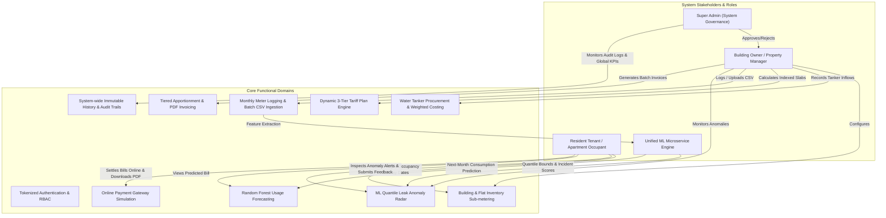
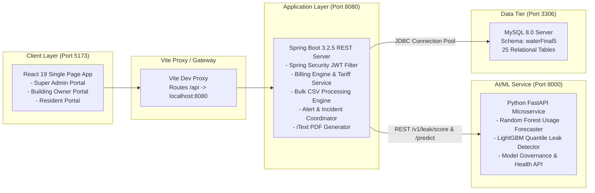

# AquaFlow / AquaTrack: Smart Water Billing & Management System
## Executive Project Overview & System Charter

---

### 1. Executive Summary & Objective

**AquaFlow (AquaTrack)** is an enterprise-grade, multi-tenant smart water utility billing, leak detection, and consumption management platform. Designed specifically for gated communities, multi-apartment residential complexes, and commercial properties, the platform transitions traditional flat-rate water billing into an equitable, consumption-driven, procurement-indexed utility model.

#### Problem Statement Addressed:
1. **Inequitable Flat-Rate Billing**: Traditional multi-dwelling residential buildings divide monthly municipal or tanker water costs equally among all residents, subsidizing high-consumption households while penalizing conservation-conscious families and vacant flats.
2. **Volatile Water Procurement Costs**: Urban residential societies frequently depend on supplemental private water tankers whose daily procurement rates fluctuate dynamically based on seasonal droughts and vendor pricing. Static tariff structures result in massive operating deficits for building societies.
3. **Undetected Plumbing Leaks**: Internal cistern overflows, concealed pipe ruptures, and faulty valves leak millions of litres undetected, causing exorbitant utility bills and property damage before physical inspection occurs.
4. **Lack of Resident Transparency & Sub-metering Accountability**: Without granular sub-meter tracking, predictive consumption analytics, and tamper-resistant digital PDF invoices, resident disputes stall payment collections and strain tenant-management relationships.

#### Core Project Objective:
AquaFlow delivers an automated end-to-end digital ecosystem providing:
- **Sub-Meter Water Auditing**: Apartment-level digital meter reading logging and historical trend analysis.
- **Dynamic 3-Tier Procurement Tariff Engine**: Automatic calculation of tiered billing slabs indexed directly to weighted-average tanker water procurement costs plus society maintenance markups.
- **AI/ML Leak Detection & Anomaly Radar**: Real-time quantile regression analysis ($q_{0.10}, q_{0.50}, q_{0.90}$) adjusting for household occupancy size and resident away periods to flag anomalous consumption spikes and active leaks before bills are published.
- **AI/ML Next-Month Consumption Forecasting**: Random Forest regressor with seasonal lag features providing residents with proactive consumption and cost estimates.
- **Automated Invoicing & Dispute-Proof PDF Billing**: Instant generation of breakdown-complete PDF tax statements with integrated online payment gateway simulation.
- **Role-Based Governance (RBAC)**: Segregated administrative workflows across Super Administrators, Property Building Owners, and Resident Tenants.

---

### 2. High-Level System Scope & Actors

---

### 3. Technology Stack Summary

| Layer | Component | Technology / Version | Role in AquaFlow |
| :--- | :--- | :--- | :--- |
| **Frontend UI** | Framework | **React 19.0.0** | Modern functional UI with Concurrent React and Hooks |
| | Router | **React Router DOM 7.1.0** | Client-side routing, protected layouts, role-based guards |
| | Design System | **Bootstrap 5.3.3 + Icons 1.11.3** | Responsive dashboard grid, modal dialogues, sleek widgets |
| | Data Visualization | **Recharts 3.10.1** | Interactive consumption area/bar charts, leak radar metrics |
| | HTTP Client | **Axios 1.7.2** | Interceptor-driven REST communication with JWT bearer injection |
| | Build Tooling | **Vite 6.0.0 / 6.4.3** | Instant HMR, lightning bundling, environment proxies |
| **Backend Server** | Framework | **Spring Boot 3.2.5** | Enterprise MVC framework with modular service architecture |
| | Language | **Java 17 (LTS)** | Modern Java features, records, pattern matching, virtual threading ready |
| | Security | **Spring Security 6.2.4** | Stateless security filter chain, BCrypt password hashing |
| | JWT Tokens | **JJWT 0.11.5** | HMAC-SHA256 signed bearer authorization tokens |
| | Persistence | **Spring Data JPA / Hibernate 6.4.4** | ORM mapping, automatic schema synchronization, query builder |
| | Document Engine| **iText PDF 5.5.13.3** | Dynamic server-side printable PDF utility bill generator |
| | API Docs | **Springdoc OpenAPI / Swagger UI 2.5.0** | Real-time OpenAPI 3.0 interactive API documentation |
| **Database** | Relational DB | **MySQL 8.0 / MariaDB** | ACID compliant relational storage (`waterFinal5` schema) |
| | Connection Pool| **HikariCP 5.0.1** | High-throughput asynchronous JDBC connection pooling |
| **ML Microservice**| Framework | **FastAPI 0.111.0 / Uvicorn 0.30.0** | High-performance asynchronous Python REST microservice |
| | Language | **Python 3.14** | Core numerical and machine learning execution environment |
| | ML Algorithms | **LightGBM 4.5.0 + Scikit-Learn 1.5** | Quantile regressors ($q_{10}, q_{50}, q_{90}$) & Random Forest regressor |
| | Numerical Stack| **Pandas 2.2 + NumPy 1.26** | Rolling feature transformations, lag matrices, z-score analytics |

---

### 4. Key Differentiating Features & Innovations

1. **Procurement-Indexed Dynamic Tariff Model**:
   Unlike legacy systems with static pricing, AquaFlow computes the Weighted Average Procurement Cost ($WAPC$) across all private water tankers purchased during a billing cycle. A customizable society markup is applied to derive the Base Tariff, which automatically scales through 3 consumption brackets:
   $$\text{Tier 1: } \text{Base Rate } \times 1.0 \quad (0-20\text{ kL})$$
   $$\text{Tier 2: } \text{Base Rate } \times 1.25 \quad (21-40\text{ kL})$$
   $$\text{Tier 3: } \text{Base Rate } \times 1.50 \quad (41+\text{ kL})$$

2. **Occupancy-Normalized AI Leak Radar**:
   Rather than crude threshold alerts, the integrated LightGBM Quantile ML model evaluates consumption per capita based on confirmed household occupancy (adults, children, and room configuration) and deducts registered resident away periods. An anomaly score between $0.0$ and $1.0$ is computed with automated incident classification (`SUSPECTED_LEAK`, `CONFIRMED_LEAK`, `ANOMALOUS_SPIKE`).

3. **Closed-Loop Resident Incident Feedback**:
   Residents receive instant notifications regarding abnormal water draws and can submit structured feedback (`CONFIRMED_LEAK`, `FALSE_POSITIVE_GUESTS`, `PLUMBING_REPAIRED`, etc.). This closes the resolution loop and dynamically retrains the threshold parameters.

4. **Batch CSV Bulk Billing Pipeline with Server Pre-Validation**:
   Property owners can upload building-wide meter reading CSV spreadsheets. AquaFlow executes pre-validation against previous cycle meter readings, catches negative or duplicate consumption, previews total estimated revenue, and commits water usages, bills, and PDF invoices in an atomic transaction.

5. **Tokenized Secure Resident Onboarding**:
   Residents cannot register directly into buildings without authorization. Building owners issue tokenized cryptographic invitations. Residents click the verification link, review their assigned apartment details, establish credentials, and automatically activate their billing accounts.

---

### 5. Architectural High-Level Topology

