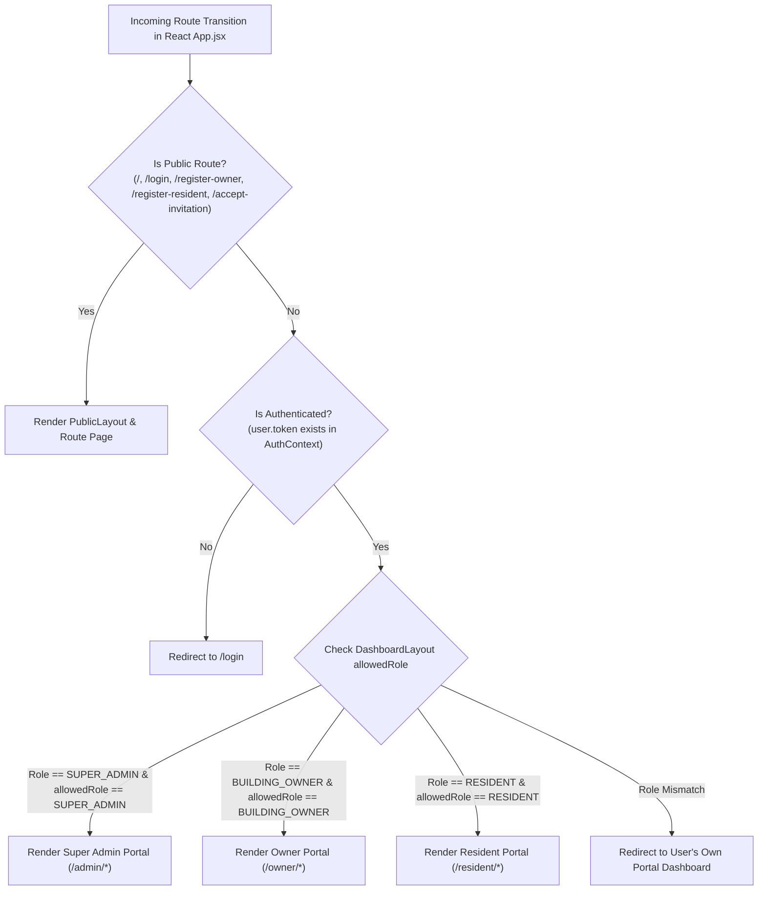

# AquaFlow / AquaTrack: Role & Permission Matrix (RBAC)

---

## 1. System Role Definitions & Governance Responsibilities

| Role Identifier | Role Title | Core Purpose & Scope of Authority |
| :--- | :--- | :--- |
| **`ANONYMOUS`** | Public Visitor | Unauthenticated guest browsing public pages (landing, documentation, self-registration, invitation acceptance). |
| **`SUPER_ADMIN`** | Platform Administrator | Top-tier system governance. Verifies building owners, enforces compliance, monitors platform revenue, and reviews immutable security audit trails. Cannot be registered via public forms (pre-seeded). |
| **`BUILDING_OWNER`** | Property Manager | Commercial/residential property operator. Configures buildings, floors, apartments, and digital sub-meters; dispatches resident invitations; logs water tanker purchases; computes dynamic tariffs; executes bulk CSV billing; monitors ML leak radars; manages invoices. |
| **`RESIDENT`** | Apartment Occupant / Tenant | Individual flat resident. Self-manages occupancy headcounts and vacation/away periods; inspects monthly water consumption; views AI next-month usage forecasts; receives leak alerts and submits plumbing feedback; pays bills online and downloads PDF statements. |

---

## 2. Comprehensive Module-Level Permission Matrix

| Functional Module | Anonymous Public | Super Admin | Building Owner | Resident Tenant |
| :--- | :---: | :---: | :---: | :---: |
| **Landing & Public Info** | Full Access | Full Access | Full Access | Full Access |
| **Owner Self-Registration** | Submit (`PENDING`) | View All | View Self | No Access |
| **Resident Invitation Acceptance** | Submit Token | No Access | No Access | Complete Own |
| **Owner Approval / Rejection** | No Access | Full Control | No Access | No Access |
| **Platform Revenue & System KPIs** | No Access | System-Wide | No Access | No Access |
| **Global Audit Trail (History)** | No Access | Full Access | Own Properties | No Access |
| **Building & Flat Inventory** | No Access | Read-Only | Full CRUD | No Access |
| **Sub-Meter Allocation** | No Access | Read-Only | Full CRUD | View Assigned |
| **Resident Directory & Invites** | No Access | Read-Only | Full CRUD | No Access |
| **Tanker Procurement Logging** | No Access | No Access | Full CRUD | No Access |
| **Dynamic Tariff Engine** | No Access | Read-Only | Generate / Edit | View Rates |
| **Bulk Meter CSV Billing** | No Access | No Access | Upload / Commit | No Access |
| **Invoice Management & PDF** | No Access | View All | View Building | View & Download Own |
| **ML Leak Monitoring Radar** | No Access | No Access | Building-Wide | Own Flat Alerts |
| **Leak Incident Feedback** | No Access | No Access | Resolve / Note | Submit Own Feedback |
| **AI Next-Month Usage Forecast** | No Access | No Access | No Access | View Own Flat Forecast |
| **Online Bill Settlement** | No Access | No Access | View Status | Pay Own Bills |
| **Occupancy & Away Declaration** | No Access | No Access | View / Override | Self-Configure |

---

## 3. Granular REST API Security Matrix

| API Endpoint | HTTP Method | Required Role Authority | Controller & Method |
| :--- | :--- | :--- | :--- |
| `/api/auth/login` | `POST` | `permitAll()` | `AuthController.login` |
| `/api/auth/register-owner` | `POST` | `permitAll()` | `AuthController.registerOwner` |
| `/api/auth/accept-invitation` | `POST` | `permitAll()` | `AuthController.acceptInvitation` |
| `/api/admin/dashboard` | `GET` | `hasRole('SUPER_ADMIN')` | `SuperAdminController.getDashboard` |
| `/api/admin/owners` | `GET` | `hasRole('SUPER_ADMIN')` | `SuperAdminController.getAllOwners` |
| `/api/admin/owners/pending` | `GET` | `hasRole('SUPER_ADMIN')` | `SuperAdminController.getPendingOwners` |
| `/api/admin/owners/{id}/approve`| `PUT` | `hasRole('SUPER_ADMIN')` | `SuperAdminController.approveOwner` |
| `/api/admin/owners/{id}/reject` | `PUT` | `hasRole('SUPER_ADMIN')` | `SuperAdminController.rejectOwner` |
| `/api/admin/history/all` | `GET` | `hasRole('SUPER_ADMIN')` | `SuperAdminController.getAuditHistory` |
| `/api/buildings` | `GET`, `POST` | `hasRole('BUILDING_OWNER')` | `BuildingController.crudBuildings` |
| `/api/apartments` | `GET`, `POST` | `hasRole('BUILDING_OWNER')` | `ApartmentController.crudApartments` |
| `/api/residents/invite` | `POST` | `hasRole('BUILDING_OWNER')` | `OwnerResidentController.inviteResident`|
| `/api/residents/resend-invite` | `POST` | `hasRole('BUILDING_OWNER')` | `OwnerResidentController.resendInvite` |
| `/api/water-purchases` | `GET`, `POST` | `hasRole('BUILDING_OWNER')` | `WaterPurchaseController.manageTankers`|
| `/api/tariff-plans/calculate/{id}` | `POST` | `hasRole('BUILDING_OWNER')` | `TariffPlanController.generatePlan` |
| `/api/billing/bulk-preview` | `POST` | `hasRole('BUILDING_OWNER')` | `BulkBillingController.previewCsv` |
| `/api/billing/bulk-commit` | `POST` | `hasRole('BUILDING_OWNER')` | `BulkBillingController.commitBatch` |
| `/api/leak/owner/incidents/cycle/{id}`| `GET` | `hasRole('BUILDING_OWNER')` | `OwnerLeakController.getCycleIncidents`|
| `/api/leak/incidents/{id}/status`| `PUT` | `hasRole('BUILDING_OWNER')` | `OwnerLeakController.updateIncident` |
| `/api/invoices/owner/building/{id}`| `GET` | `hasRole('BUILDING_OWNER')` | `InvoicesController.getInvoices` |
| `/api/bills/{id}/pdf` | `GET` | `hasAnyRole('BUILDING_OWNER', 'RESIDENT')` | `BillController.downloadBillPdf` |
| `/api/water-prediction/next-month` | `GET` | `hasRole('RESIDENT')` | `WaterPredictionController.predictUsage`|
| `/api/leak/resident/status` | `GET` | `hasRole('RESIDENT')` | `ResidentLeakAndHouseholdController.getLeak`|
| `/api/leak/resident/feedback` | `POST` | `hasRole('RESIDENT')` | `ResidentLeakAndHouseholdController.sendFeedback`|
| `/api/resident/pay` | `POST` | `hasRole('RESIDENT')` | `ResidentController.settleBill` |
| `/api/occupancy/household-size` | `PUT` | `hasRole('RESIDENT')` | `OccupancyController.updateHousehold` |
| `/api/occupancy/away-periods` | `POST` | `hasRole('RESIDENT')` | `OccupancyController.declareAway` |

---

## 4. Frontend Route Guard Matrix

