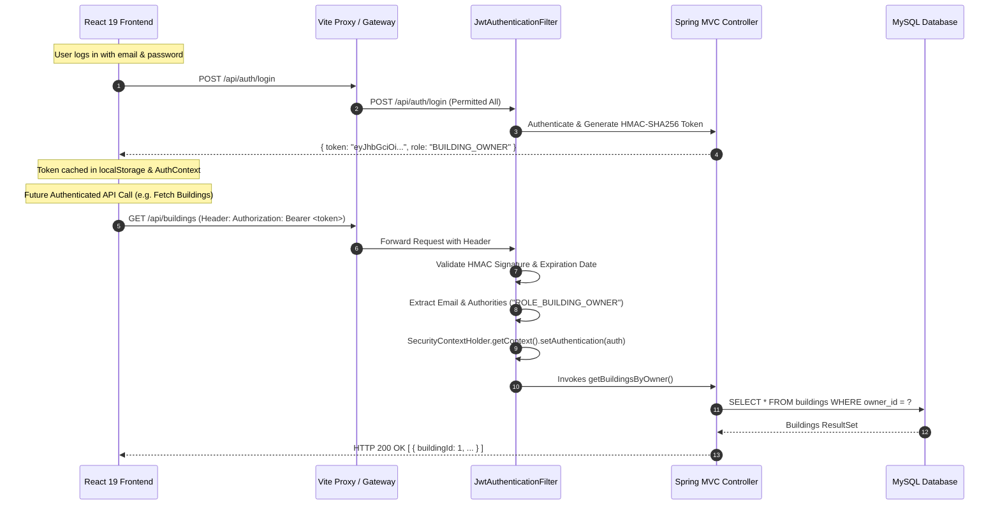
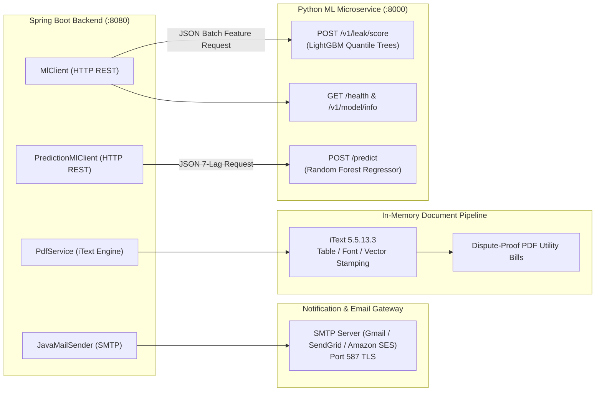

# AquaFlow / AquaTrack: System Architecture & Technical Topology

---

## 1. Overall Multi-Tier System Architecture

AquaFlow employs an enterprise multi-tier decoupled architecture separating presentation, core business logic, asynchronous machine learning inference, and transactional data persistence:

```mermaid
flowchart TB
    subgraph ClientTier["1. Presentation Tier (Client Browser)"]
        Browser["Modern Web Browser (Chrome / Edge / Firefox / Safari)"]
        SPA["React 19 Single Page Application\n- Super Admin Portal\n- Building Owner Portal\n- Resident Self-Service Portal\n- Recharts Analytics & Bootstrap 5.3"]
        Browser --- SPA
    end

    subgraph GatewayTier["2. Proxy & Gateway Tier"]
        ViteDev["Vite Development Server (:5173)\n- HMR & Static Asset Server\n- Reverse Proxy: /api -> :8080"]
    end

    subgraph AppTier["3. Application Tier (Spring Boot 3.2.5 on :8080)"]
        SecFilterChain["Spring Security 6.2.4 Filter Chain\n- CorsFilter\n- JwtAuthenticationFilter"]
        
        subgraph RESTControllers["Spring MVC REST Controllers"]
            AuthC["AuthController"]
            AdminC["SuperAdminController"]
            OwnerC["Owner & Building Controllers"]
            BulkC["BulkBillingController"]
            LeakC["Leak & Incident Controllers"]
            PredC["WaterPredictionController"]
        end
        
        subgraph CoreServices["Domain Business Services (@Transactional)"]
            AuthS["AuthService"]
            BulkS["BulkBillingService & CsvHelper"]
            TariffS["TariffCalculationService (Dynamic Slabs)"]
            LeakS["LeakDetectionService & IncidentService"]
            PredS["WaterPredictionService"]
            PdfS["PdfService (iText 5.5 Document Engine)"]
        end
        
        subgraph DataRepos["Spring Data JPA Repositories"]
            Repos["25 Domain Repository Interfaces\n(User, Building, Meter, Usage, Bill, Invoice, etc.)"]
        end
        
        SecFilterChain --> RESTControllers
        RESTControllers --> CoreServices
        CoreServices --> DataRepos
    end

    subgraph AITier["4. AI / Machine Learning Tier (Python FastAPI on :8000)"]
        FastAPIServer["FastAPI Asynchronous Web Server (Uvicorn 0.30.0)"]
        APIKeySec["Security Middleware: X-API-Key Header Validator"]
        
        subgraph MLEngines["AI Model Engines"]
            RF["Random Forest Regressor\n(/predict)\nModel: random_forest_model.pkl"]
            LGBM["LightGBM Quantile Regressors\n(/v1/leak/score)\nq10, q50, q90 Quantile Trees"]
        end
        
        FastAPIServer --> APIKeySec
        APIKeySec --> RF & LGBM
    end

    subgraph DataTier["5. Transactional Data Tier (MySQL 8.0 on :3306)"]
        Pool["HikariCP High-Throughput Connection Pool (HikariPool-1)"]
        MySQL[(MySQL Relational Database\nSchema: waterFinal5\n25 ACID-Compliant Tables)]
        Pool --- MySQL
    end

    SPA -->|HTTP / REST| ViteDev
    ViteDev -->|Proxied REST Calls| SecFilterChain
    CoreServices -->|Sync HTTP REST (timeout 5000ms)| FastAPIServer
    DataRepos --> Pool
```

---

## 2. Frontend-Backend Communication & Security Protocol

### 2.1 Communication Specification
- **Protocol**: HTTP/1.1 RESTful APIs, JSON payloads (`Content-Type: application/json`).
- **Binary Streaming**: PDF invoices are transmitted via `Content-Type: application/pdf` with `Content-Disposition: attachment; filename=...`.
- **Multipart Data**: Meter readings CSV uploads use `multipart/form-data`.
- **Reverse Proxy**: During development, the Vite server intercepts all paths matching `/api/*` and proxies them transparently to `http://localhost:8080/api/*`, eliminating Cross-Origin Resource Sharing (CORS) preflight friction while enabling production parity.

### 2.2 JWT Token Lifecycle & Security Pipeline


---

## 3. Backend Layered Architecture & Separation of Concerns

```mermaid
flowchart TD
    subgraph Presentation["Presentation Layer (com.smartwater.billing.*.controller)"]
        C1["AuthController: /api/auth/*"]
        C2["SuperAdminController: /api/admin/*"]
        C3["BuildingController: /api/buildings/*"]
        C4["BulkBillingController: /api/billing/*"]
        C5["OwnerLeakController: /api/leak/*"]
        C6["WaterPredictionController: /api/water-prediction/*"]
    end

    subgraph Service["Service Layer (com.smartwater.billing.*.service)"]
        S1["AuthService & CustomUserDetailsService"]
        S2["SuperAdminService"]
        S3["BuildingOwnerService & ApartmentService"]
        S4["BulkBillingService & TariffCalculationService"]
        S5["LeakDetectionService & LeakIncidentService"]
        S6["WaterPredictionService & AlertEngineService"]
        S7["PdfService (iText Document Formatter)"]
    end

    subgraph Persistence["Persistence & DAO Layer (com.smartwater.billing.*.repository)"]
        R1["UserRepository & BuildingOwnerRepository"]
        R2["BuildingRepository & ApartmentRepository"]
        R3["WaterMeterRepository & WaterUsageRepository"]
        R4["BillingCycleRepository & TariffPlanRepository"]
        R5["BillRepository & InvoiceRepository"]
        R6["LeakIncidentRepository & LeakFeedbackRepository"]
        R7["WaterUsagePredictionRepository"]
    end

    subgraph Entity["Domain Entity Layer (com.smartwater.billing.*.entity)"]
        E1["User, BuildingOwner, Resident"]
        E2["Building, Apartment, WaterMeter"]
        E3["WaterUsage, BillingCycle, TariffPlan"]
        E4["Bill, Invoice, Payment"]
        E5["LeakIncident, LeakFeedback, AwayPeriod"]
    end

    C1 & C2 & C3 & C4 & C5 & C6 --> S1 & S2 & S3 & S4 & S5 & S6 & S7
    S1 & S2 & S3 & S4 & S5 & S6 & S7 --> R1 & R2 & R3 & R4 & R5 & R6 & R7
    R1 & R2 & R3 & R4 & R5 & R6 & R7 --- E1 & E2 & E3 & E4 & E5
```



---

## 4. External & Microservice Integration Architecture

AquaFlow communicates across 3 critical sub-systems:



### Integration Resiliency Safeguards:
1. **Circuit-Breaking & Fallbacks**:
   - `MlClient` features a fallback to statistical baselines ($\mu + 2\sigma$). If FastAPI is uncontactable, billing cycles are scored without error.
   - `PredictionMlClient` implements dynamic fallback to historical weighted rolling averages if the Python inference engine experiences a timeout.
2. **Synchronous vs. Asynchronous Decoupling**:
   - User-facing meter batch ingestion commits transactional records first. Anomaly scoring is scheduled asynchronously via `@Async` with `CompletableFuture<Void>`.

---

## 5. Deployment Topology & Production Environment

```mermaid
flowchart TD
    subgraph HostServer["Host Environment / Container Orchestrator"]
        subgraph Ingress["Web Server & Reverse Proxy"]
            Nginx["Nginx Reverse Proxy / Load Balancer (Port 80 / 443)\n- SSL Termination\n- Serves React Static Bundle (/var/www/html)\n- Reverse Proxies /api/* to Spring Boot (:8080)"]
        end
        
        subgraph AppServiceContainer["Java Runtime Environment Container"]
            JVM["OpenJDK 17 LTS / Spring Boot Uber JAR (:8080)\n- Active Profile: mysql\n- HikariCP Connection Pool (Max: 20 connections)\n- Embedded Apache Tomcat Server"]
        end
        
        subgraph AIServiceContainer["Python Runtime Container"]
            PyEnv["Python 3.14 Runtime / Uvicorn Asynchronous Worker (:8000)\n- FastAPI Framework\n- Pre-loaded In-Memory ML Models"]
        end
        
        subgraph DatabaseContainer["Database Cluster Container"]
            MySQLServer["MySQL 8.0 Community Server (:3306)\n- InnoDB Storage Engine (Row-Level Locking)\n- Database Schema: waterFinal5\n- Persistent Named Volume Storage"]
        end
    end

    Nginx -->|Proxy Pass /api| JVM
    JVM -->|REST API Calls (Internal Docker Network)| PyEnv
    JVM -->|JDBC TCP Connection| MySQLServer
```
